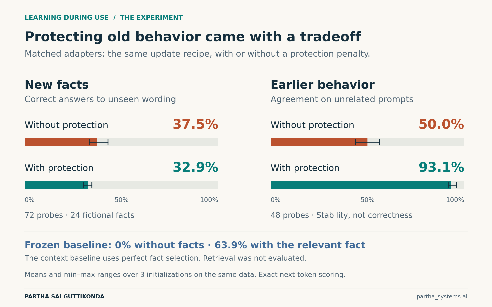

# Adaptive LLM Experiments

Can a language model learn new facts through weight updates while preserving
earlier behavior? This repository contains two small, reproducible experiments,
their recorded results, and the illustrated article
[What If LLMs Could Learn While You Use Them?](docs/article.md).

The LLM experiment updates small internal adapters **between requests**. A separate
symbolic-memory experiment explores how training a representation can make a later
gradient update more useful. Neither experiment reproduces In-Place TTT, TTT-E2E,
or Titans; those methods are discussed as related research.



## What we measured

| Condition | Correct new-wording answers | Agreement with earlier predictions |
|---|---:|---:|
| Frozen model without the facts | 0.0% | 100.0% by definition |
| Internal adapter without protection | 37.5% | 50.0% |
| Internal adapter with protection | 32.9% | 93.1% |
| Frozen model supplied the relevant fact | 63.9% | Not evaluated in this condition |

Fact accuracy uses 72 one-token completions about 24 fictional projects. Stability
uses 48 unrelated prefixes. Adapter numbers are means across three initializations
on the same dataset. **Agreement is a stability measure, not answer correctness.**
The context baseline uses perfect fact selection; it does not evaluate retrieval.

Adding protection improved stability while reducing new-fact recall in the matched
comparison. Saving and reloading the protected seed-7 adapter in a fresh process
reproduced all 72 predictions and target probabilities.

The separate toy memory task reached 100% recall after meta-training, compared with
87.7% for random representations and 16.7% with no memory write. Every queried
association was supplied before recall. This is **not a language-model result**.

## Start here

- [Read the illustrated article](docs/article.md).
- [Inspect the protocol, all recipes and limitations](docs/methods.md).
- [Read the audited summary](results/summary.json) or [per-probe predictions](results/predictions.csv).
- [Browse the PNG and editable SVG figures](figures/).

## Check the recorded results without downloading a model

```bash
git clone https://github.com/propardhu/adaptive-llm-experiments.git
cd adaptive-llm-experiments
python3 analyze.py
```

This standard-library-only command audits 2,784 stored LLM probe records and the
symbolic-memory totals, then regenerates the summary and predictions CSV. It does
not rerun training or independently reproduce the model's outputs.

## Run the experiments

The reference runs used Python 3.12.14, PyTorch 2.6.0+cpu, Transformers 4.49.0 and
float32 on Linux CPU. Use Python 3.12 to match the reference environment.

```bash
python3 -m venv .venv
source .venv/bin/activate
python -m pip install -r requirements.txt

# Tiny symbolic-memory study; no model download.
python episodic_memory.py --output results-my-run/memory

# LLM development selection and final runs, then the matched control.
python experiment.py --output results-my-run
python matched_control.py --results results-my-run
python verify_reload.py --results results-my-run
```

The LLM script downloads `HuggingFaceTB/SmolLM2-135M`, pinned to revision
`93efa2f097d58c2a74874c7e644dbc9b0cee75a2`. The base model is not bundled.
Use a fresh output directory as above to preserve the included reference results.
The main script offers `--device cuda` and `--device mps`, but only CPU was tested;
the matched-control and fresh-process reload scripts use CPU.

To check the saved reference adapter directly:

```bash
python verify_reload.py --results results
```

This downloads/loads the pinned base model and compares its adapted outputs with
the stored predictions. It is a stronger check than auditing the JSON alone.

## Files

| File or directory | Purpose |
|---|---|
| `data.py` | Fixed development and final-test examples |
| `experiment.py` | Adapter implementations, development selection and final evaluation |
| `matched_control.py` | Follow-up control with the protection penalty removed |
| `verify_reload.py` | Fresh-process check of the saved adapter |
| `episodic_memory.py` | Separate gradient-memory and meta-training experiment |
| `analyze.py` | Audit stored records and derive reported numbers |
| `results/` | Protocols, all development/final measurements, predictions and small checkpoints |
| `previous_experiment/` | Earlier exploratory summary, not a controlled comparison |
| `docs/` | Article, detailed methods and publication notes |
| `figures/` | PNG images and editable SVG sources |

## Rebuild the article and figures

```bash
python -m pip install -r requirements-publication.txt
python make_figures.py
python make_article.py
python export_article.py
```

The Word and self-contained HTML reading copies are generated locally and ignored
by Git. The GitHub-readable article is generated from `article_content.json`.
Quantitative charts use the audited reference results. If you substitute new
measurements, review the prose too; it is not an automatically generated report.

## Scope and reproducibility

This is an exploratory study of one small base completion model and synthetic
facts. The matched control was added after the primary run without further tuning.
The three seeds repeat the same task data, and plotted ranges are not confidence
intervals. The work does not establish faster serving, lower total cost, broad
reasoning gains, or improvement across many conversations.

Full details—including the implementation smoke test, selection rule, all recipes,
timing boundaries, expected-answer checks and access limitations for official TTT
checkpoints—are retained in [the methods](docs/methods.md).

Author: **Partha Sai Guttikonda** · **partha_systems.ai**

The upstream model has its own [model card and license](https://huggingface.co/HuggingFaceTB/SmolLM2-135M).
No separate license has been selected for this repository.
