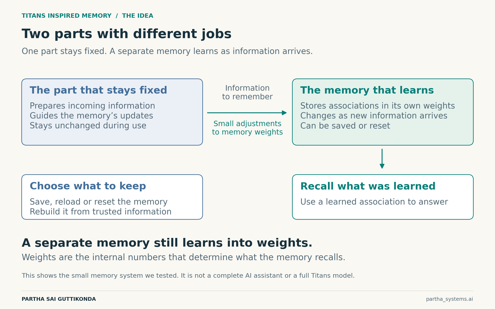
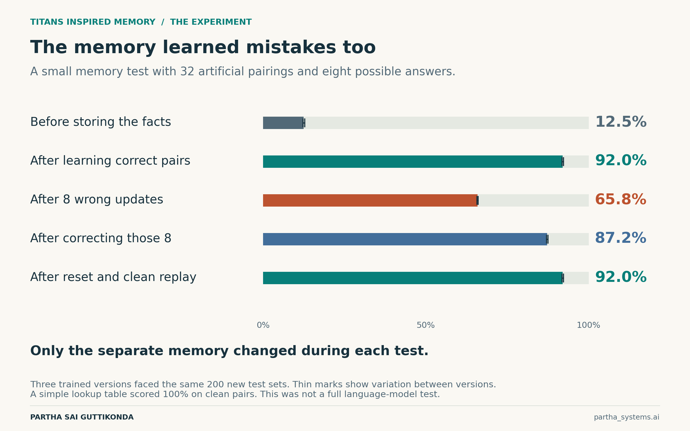

# Giving AI a Memory We Can Manage

What Titans suggests about AI that learns during use

**Partha Sai Guttikonda**

Imagine an AI assistant that gradually learns how your team works. It picks up your project names and understands the terms you use. Then an outdated document teaches it something wrong. How do you undo that mistake?

That question is why I find **Titans** interesting. This research approach gives AI a separate memory that learns as new information arrives, while the main model’s shared settings can stay fixed. It offers a useful place to manage what changes during use. [1]

Think of a notebook beside someone’s general knowledge. The analogy has a limit: this memory does not store neat sentences on a page. It learns by changing numbers inside a small neural network. Those numbers are called **weights**, and changing them changes what the memory recalls.

So Titans still updates weights, but in a dedicated memory. An application can keep that memory, save it for later, or reset it. Persistence depends on those choices.

*Figure 1. The separation we tested. Learning changes the memory’s own weights. Our experiment uses a small memory system, not a complete AI assistant.*

For a future assistant, this could mean keeping each person’s learned information separate and restoring an earlier memory after a bad update. Those controls would need to be built into the product.

To explore the idea, I tested a tiny memory inspired by Titans. Its task was to learn 32 artificial pairings, matching coded inputs to one of eight answers. This tested remembering associations, not understanding conversation. Three independently trained versions faced the same 200 new sets.

*Figure 2. Average recall across the three trained versions. Each result covers 19,200 answers on the same 200 test sets. Thin marks show variation between versions, not confidence intervals.*

With correct information, the memory answered **92.0%** correctly. After I supplied wrong answers for eight of the 32 pairings, accuracy fell to **65.8%**. The fixed part of the system remained unchanged, yet its memory now led it astray.

Correcting those eight entries brought accuracy back to 87.2%. Clearing the memory and teaching it the original correct pairings again restored 92.0%. Saving and reloading the tested memories also reproduced their answers exactly.

**A memory can learn a mistake as readily as a useful fact.** A filter helped when it rejected the false updates, but we had told it exactly which sources to trust. We did not build an automatic fact checker.

The limits matter too. A simple lookup table scored 100% on the clean task. Our neural memory became less accurate as it had more to remember. This experiment shows how memory can be managed; it does not establish that Titans beats other AI systems or lowers their costs.

Two related approaches are worth a brief mention. **In-Place TTT** turns parts already inside a model into adaptable memory. **TTT-E2E** trains a model to benefit from later learning as it predicts the next pieces of text. Both update selected internal weights during use. We did not test them here. [2, 3]

For me, the appeal is an assistant whose learning we can manage. Useful experience could carry forward, while a mistaken update could be corrected or rolled back. The harder question remains deciding which experience deserves to become a memory.

## Research sources

1. [Titans — Learning to Memorize at Test Time](https://arxiv.org/abs/2501.00663)
2. [In-Place Test-Time Training](https://arxiv.org/abs/2604.06169)
3. [End-to-End Test-Time Training for Long Context](https://arxiv.org/abs/2512.23675)
