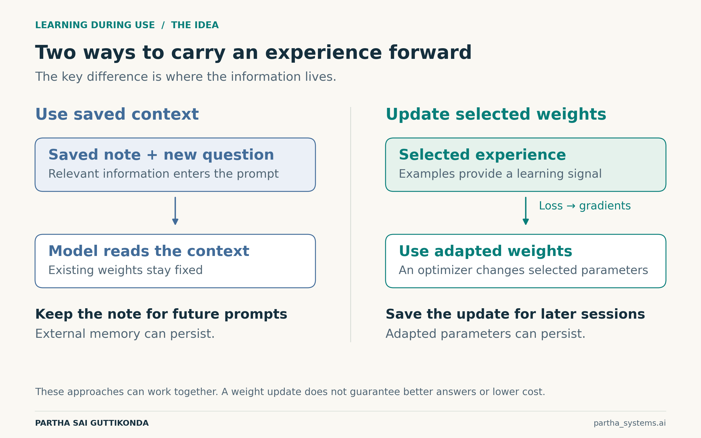
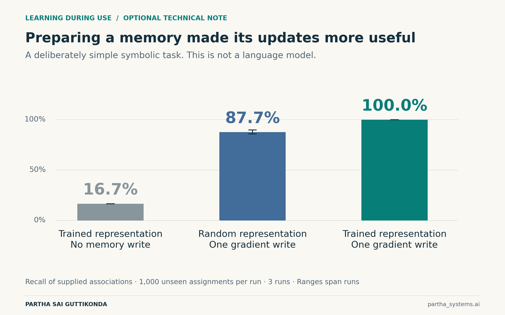

# What If LLMs Could Learn While You Use Them?

A small experiment in updating model weights and keeping what already works

**Partha Sai Guttikonda** · partha_systems.ai

Imagine teaching a coding assistant your team’s naming conventions. It follows them in the current conversation. Next week, on another project, it still needs access to those same conventions.

We can store them in files or saved memory and bring the relevant information into future prompts. But could useful experience also change the model’s weights, so it carries some of what it learned into later answers?

That possibility drew me to learning during inference. I wanted to test a small piece of it: can a weight update help with new questions while preserving earlier behavior?

## An answer can change without the weights changing

In standard inference, an LLM predicts tokens using its existing weights and the supplied context. An example can change the answer while the weights stay fixed. Weight adaptation adds a loss that scores error. Gradients indicate how changing selected weights affects that loss; an optimizer makes the update.

Figure 1. Context and weight updates are two ways to carry information forward. Saved context can persist without changing model weights; adapted weights must also be retained to affect a later session.

The whole model does not need to change. A small set of adjustable parameters can be enough to test the idea.

## Teaching a model 24 new facts

We used SmolLM2-135M, a small language model, and added trainable adapters inside two of its layers. Its original weights stayed frozen. The adapters learned between requests, rather than during each generated token. [1]

Each of 24 fictional projects had a color code. We taught each fact in four phrasings, then tested three unseen phrasings per project: 72 questions. The evaluation prompts contained no source fact. We scored the next answer token, so this was a narrow recall test. One taught fact was “Project Belvar uses the access code green.” The test asked for that code using different wording. Before adaptation, the model scored 0/72.

The comparison used the same update recipe with one difference: a protection penalty that discouraged changes to the model’s predictions on separate, unrelated examples.

Figure 2. Means across three initializations on the same test set; small marks show the range. Both adapter conditions used the same initialization, fact batches, learning rate and 160 updates. Agreement measures stability, not answer correctness.

Protection raised agreement with earlier predictions from 50% to 93.1%. But correct answers to new question wordings fell from 37.5% to 32.9%. We had made the model more stable while weakening its new learning.

Context remained stronger on this task. Giving the frozen model the perfectly selected relevant fact produced 63.9% accuracy. We did not build a retrieval system; we supplied the right fact directly. Weight adaptation still has to demonstrate when its additional work is worthwhile.

## Research is making adaptation part of the design

Test-time training, or TTT, studies updates made while a model processes test-time information. The challenge is to choose what should change and prepare the model to benefit from those changes.

![Figure 3. Three published approaches to learning during use. These are research methods, not interchangeable serving engines. Our local adapter experiment does not reproduce their architectures or reported results. [2–4]](../figures/05-ttt-research-map.png)

Figure 3. Three published approaches to learning during use. These are research methods, not interchangeable serving engines. Our local adapter experiment does not reproduce their architectures or reported results. [2–4]

In-Place TTT updates selected feed-forward weights as context arrives in chunks. Its reported setup includes continued training. TTT-E2E uses meta-training to prepare the model for later updates: training rewards predictions made after adaptation. Titans gives the model a dedicated neural memory, with mechanisms for writing and forgetting. [2–4]

These approaches make preparation part of the solution. A gradient tells an optimizer how to change a weight to reduce a chosen loss. The loss, the adjustable parameters and the training process determine whether that change becomes useful.

For a deployed assistant, the runtime would also need to coordinate updates with answering, keep users’ adapted states separate, and support rollback. Derivative computation is one part of that system.

Learning within a long context also differs from retaining improvements across conversations. Persistent learning requires an explicit decision about which updated state to save and reuse.

## What useful progress would look like

A coding assistant might learn conventions that transfer to unfamiliar code. A writing assistant might adapt to repeated editorial feedback. Those are attractive possibilities because the benefit would extend beyond recalling one sentence.

Weight updates could reduce some repeated context, but token savings are not automatic. The model must first read the experience and spend compute updating. Exact facts may still be better retrieved. Any efficiency claim needs the full cost of learning and answering.

We did verify one form of persistence: saving an adapter and loading it in a fresh process reproduced all 72 recorded predictions. That establishes that an update can be restored. Repeated improvement across many sessions remains untested.

The next evaluation should ask whether the model handles new tasks better, retains earlier capabilities, and keeps improving after multiple updates. It should compare against strong context baselines and count the extra time and memory.

I see learning during use as a plausible part of the next wave of LLM development. The goal is an assistant whose experience leads to measurable improvement, without making the tasks we already trust it with less reliable.

## Methods and sources

This exploratory study used synthetic facts, a single small model, and three initializations on the same data. Separate development examples selected the settings. The matched comparison was added afterward without further tuning. All conditions and per-question predictions are included in the project.

### Further reading

- [1  SmolLM2 model card](https://huggingface.co/HuggingFaceTB/SmolLM2-135M)
- [2  In-Place Test-Time Training](https://arxiv.org/abs/2604.06169)
- [3  End-to-End Test-Time Training for Long Context](https://arxiv.org/abs/2512.23675)
- [4  Titans: Learning to Memorize at Test Time](https://arxiv.org/abs/2501.00663)
- [5  Official TTT-E2E code and checkpoint information](https://github.com/test-time-training/e2e)

The downloadable project contains the protocols, all measured results, code and run instructions. Research sources checked on 25 October 2026. The optional technical note describes the separate symbolic-memory experiment.

Optional technical note and experiment details

## Optional technical note on learning to learn

A separate synthetic experiment tested one related mechanism. Twelve symbols received new values in each episode. A 144-parameter encoder represented those symbols; one gradient step wrote the observed associations into a temporary memory matrix. Outer training adjusted the encoder to make recall after that write more accurate.

Supplementary figure. Every queried association was supplied before recall. This is a symbolic memory experiment, not an LLM benchmark or a reproduction of TTT-E2E or Titans.

Recall averaged 87.7% with random representations and reached 100% after outer training. Disabling the memory write left recall at 16.7%. Each of three runs evaluated 1,000 new assignments. This deliberately easy task illustrates how preparation can improve a gradient update; it establishes no result about language understanding or lifelong learning.

## Details behind the LLM comparison

The internal adapters added 33,792 trainable parameters. A KL penalty matched the frozen model’s probability distribution on 48 fitting prefixes; another 48 tested behavioral stability. On eight expected-answer probes, the frozen model scored 5/8, the matched unprotected adapter 2/8, and the protected adapter 4/8. Protection helped without fully preserving that score.

Both experiments ran on Linux CPU. We did not evaluate the official TTT systems. The released TTT-E2E checkpoint required a billing project to download, and its documented implementation targets a GPU stack. Code, fixed datasets, all tested settings, checkpoints and raw results are in the accompanying project. [5]

